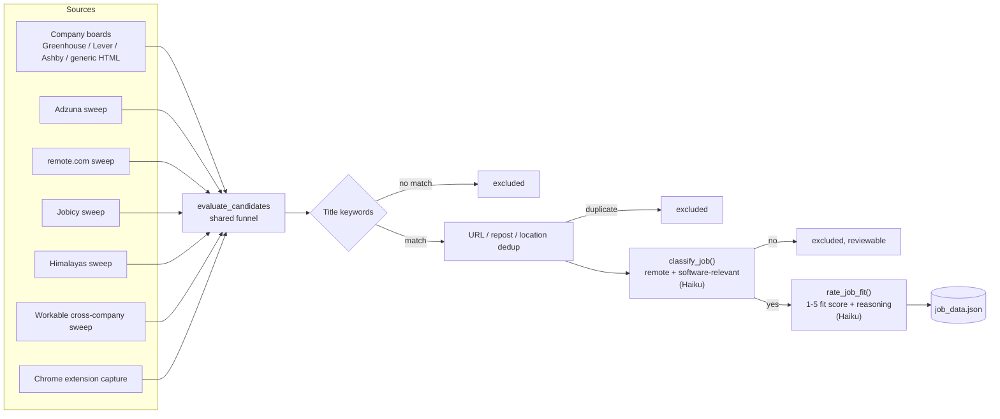
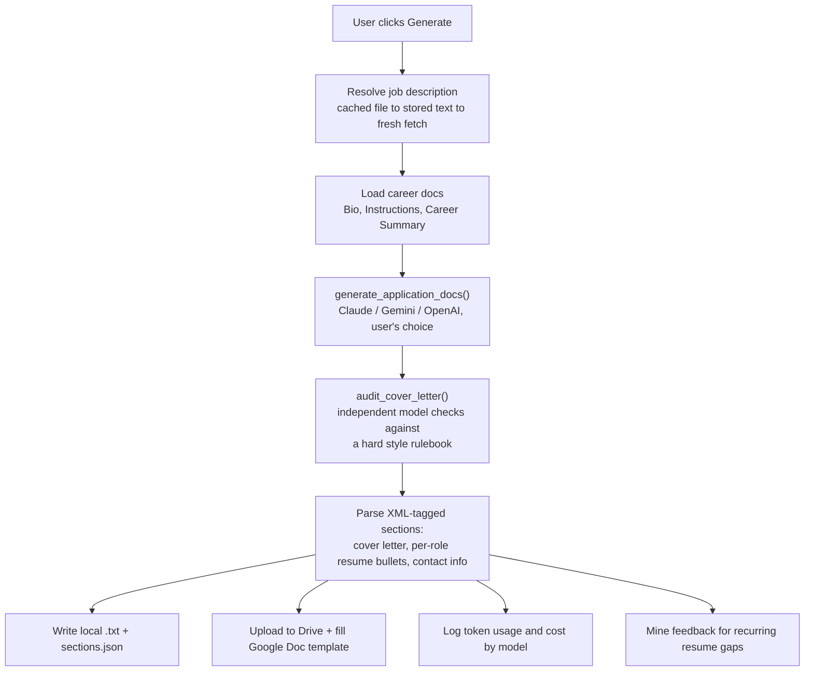

# Goat Search

A personal job-search agent: it scrapes job postings from multiple sources, filters and
classifies them against a candidate's real background using LLMs, drafts tailored application
materials (cover letter, resume bullets, Google Doc output), preps interview questions, and
tracks the whole pipeline — screened → applied → interviewed — in a local dashboard with
historical cost/token metrics.

Single-user, runs entirely locally. Built iteratively over several months as a real tool used
for a real job search, not a demo — every feature below was built in response to an actual gap
found while using it.

## Why this exists

Generic job boards surface volume, not fit. This project inverts that: it pulls candidates from
six different sources, runs every single one through the same classification and fit-rating
funnel against the user's actual career background, and only then presents a short, ranked list
of real candidates — with the reasoning for every inclusion and exclusion kept visible and
reversible.

## Architecture

Two files hold essentially all of the application logic, intentionally — no framework, no
build step, no ORM:

| Layer | File | What it is |
|---|---|---|
| Backend | `job_checker.py` (~7,000 lines) | Flask app — every route, scraper, and LLM call, in one file |
| Frontend | `index.html` (~4,500 lines) | The entire UI — inline CSS + vanilla JS, a hash router, zero dependencies |
| Working-set store | `job_data.json` | Companies, tracked jobs, settings — read/written wholesale per request |
| Permanent records | `applications/<Company>/<Title>/<Date>/` | Generated cover letters, resumes, interview prep — never purged |
| Long-term metrics | `metrics.db` (SQLite) | Daily time-series: funnel counts, token usage/cost by model |

**Why no database for the main data model?** At this scale (a few thousand jobs, single user,
no concurrent writers beyond the app itself), a JSON blob with atomic writes (`tempfile` +
`os.replace`) is simpler to reason about than a schema migration story, and it's trivially
inspectable by hand. The one place a real database earns its keep — long-term metrics that need
daily granularity for trend charts — got a dedicated SQLite file instead of bolting more ad hoc
counters onto the JSON blob.

**Why a Chrome extension too?** Server-side scraping structurally can't get past bot-blocked
sites or JS-rendered pages. The extension captures whatever's already rendered in the user's own
authenticated browser session and posts it to the same classification pipeline — same funnel,
different entry point.

## Core workflow: ingestion

Six independent sources feed one shared funnel — no source gets a shortcut around it:



Every automatic exclusion is persisted with the model's reasoning and stays reviewable/
reversible — nothing is a silent drop. A weaker-model misclassification can be escalated to a
stronger model for a second opinion (`reevaluate_job`) rather than trusting the first verdict
forever.

## Core workflow: application generation



The generation call and the audit call are deliberately independent models by default (e.g.
Sonnet writes, Opus audits) — the same model grading its own work tends to miss the same
mistakes it makes.

## Feature areas

- **Jobs** — Found / Screened / Excluded, with live keyword re-scoring, LinkedIn-connection
  matching, and a persistent, filterable record of every automatic rejection and why.
- **Applications** — every generated application, sourced from disk so it survives the 30-day
  working-set retention window on the job list itself. Supports per-generation model choice,
  additional free-text instructions, and a structured cover-letter audit against a fixed style
  rulebook (no em dashes, no fabricated numbers, no buzzwords, one idea per sentence, etc.).
- **Interviews** — once an application moves to interviewing, drafts round-specific prep
  questions (recruiter screen vs. an adaptive prompt for later rounds, grounded in named
  specifics from the candidate's real background) with support for multiple rounds per
  application.
- **Practice** — rehearse either generic recruiter questions or any already-generated
  job-specific question. Supports dictation via the browser's native speech API; submitting an
  answer returns structured feedback (strengths / improvements / delivery / overall), checked
  against the candidate's own background doc so an unsupported claim gets flagged rather than
  assumed true.
- **To Do** — mines recurring "missing information" gaps out of generation feedback into a
  vote-ranked Google Doc, so the same gap mentioned across many applications surfaces instead of
  getting lost in one-off feedback.
- **Data** — a 30-day funnel (Sankey diagram, hand-rolled SVG), permanent lifetime counters, a
  per-model cost breakdown, and a token-usage trend chart per application over time.

## Multi-provider model support

Generation and the cover-letter audit can run on any of three providers, picked per-generation
without changing the standing default:

| Provider | Tiers |
|---|---|
| Anthropic | Haiku · Sonnet · Opus |
| Google Gemini | Flash Lite · Flash · Pro |
| OpenAI | three tiers, cheapest to flagship |

Classification, fit-rating, and interview-prep generation stay Claude-only by deliberate scope
decision — those are automated, high-volume pipeline steps rather than a one-off creative
artifact, so provider choice there would add complexity without a clear user-facing benefit.

## Notable engineering problems solved

A few representative ones, out of many documented in `PROBLEMS.md` / `CLAUDE.md`:

- **A non-atomic write race corrupted the data file under concurrent requests.** `open(path, 'w')`
  truncates before writing; a request landing in that window read a 0-byte file. Fixed with
  `tempfile.mkstemp()` + `os.replace()` (atomic on POSIX/Windows), verified with a concurrency
  stress test (1,101 failures under the old code → 0 under the new one, same load).
- **A Google Drive folder race created duplicates.** Drive Desktop's own background sync and this
  app's direct Drive API calls could both decide a folder didn't exist yet and create it
  independently. Root-caused after two failed timeout-based mitigations; the actual fix was
  removing the race's precondition entirely — local writes moved to a path Drive Desktop never
  watches, making this app the only writer.
- **A cheap classifier's mistakes were invisible.** Early on, a misclassified job was just gone —
  no record, no way to notice the pattern. Added a persistent, reviewable Excluded list with the
  model's reasoning attached, plus a one-click escalation path to a stronger model for a second
  opinion on just the judgment-call rejections.
- **Fit-rating was the single largest cost in the pipeline.** It was sending a ~72,000-character
  background doc on every call. Measured, then fixed by building a separate, deliberately short
  career-summary doc for this one use case — cut that call's input tokens by roughly 90% with no
  loss in rating quality.

## Tech stack

Python (Flask, `requests`, BeautifulSoup, `sqlite3`), vanilla JS/HTML/CSS (no build step, no
framework), Anthropic / Google Gemini / OpenAI SDKs, Google Drive & Docs APIs (OAuth), SQLite,
a Manifest V3 Chrome extension, `launchd` for scheduled runs.

## Running it

```bash
pip install -r requirements.txt
python job_checker.py                 # web app at http://localhost:5000
python job_checker.py --dev           # isolated dev data file, for safe local testing
python job_checker.py --get-new-jobs  # run the full ingestion pipeline once and exit
```

Configuration lives in a gitignored `.env` (Anthropic/Gemini/OpenAI API keys, Adzuna credentials,
a Google Drive output folder ID). Google Docs/Drive integration needs a one-time OAuth setup
(`python job_checker.py --google-auth`). See `CLAUDE.md` for the full configuration and
architecture reference this project's own AI-assisted development workflow is built on, and
`PROBLEMS.md` for the running log of design problems worked through along the way.
